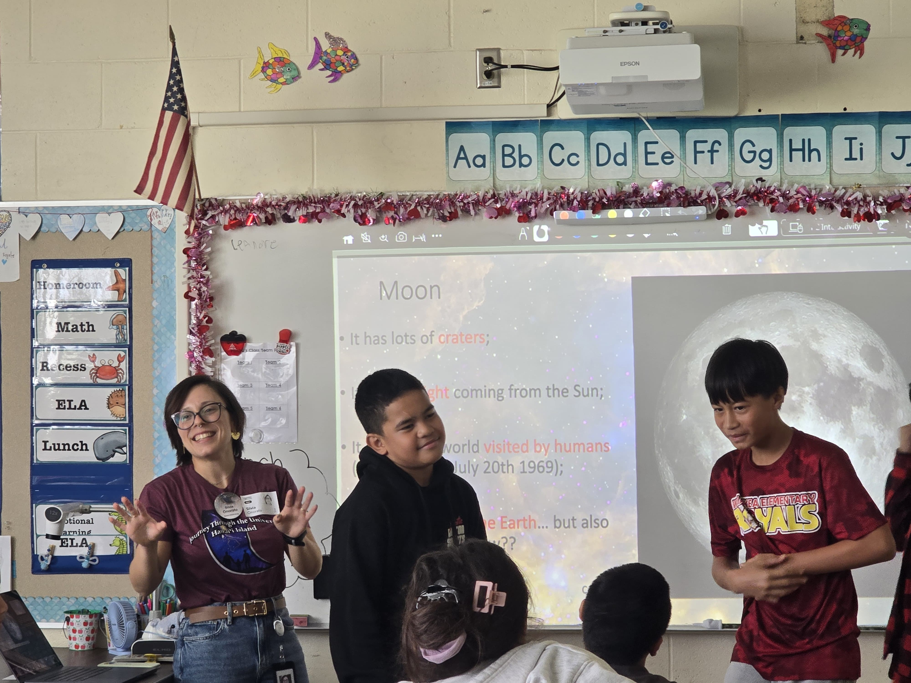

---
---



# Outreach

Sharing astronomy with the public is one of my favorite parts of this job, and I have been doing it since 2018. I started by guiding visitors through the historic Specola Astronomical Museum in Bologna. In Leiden I taught university courses as a teaching assistant. Since moving to Hawaiʻi, I join the outreach activities of Gemini Observatory / NSF NOIRLab and the Maunakea Observatories, talking about the Universe with pupils, families, and anyone curious about the sky.

---

## Astronomy on Tap Hilo: organizer & speaker (2025–present)

[Astronomy on Tap Hilo](https://astronomyontap.org/locations/hilo-hawaii/) brings public science talks to a local pub. As one of the organizers, I plan and promote the events and help the speakers prepare their talks.

In October 2026, at [Astronomy on Tap Hawaiʻi: Nāpōwawāʻenakaulua](https://astronomyontap.org/event/astronomy-on-tap-hawaii-napowawaenakaulua/) at Hale Kanikapila in Hilo, I was also a speaker. I talked about the discovery of Nāpōwawāʻenakaulua: a rare pair of supermassive black holes seen when the Universe was less than a billion years old, observed with Maunakea and space telescopes. I shared the evening with Devin Chu (ʻImiloa Astronomy Center), who explained the Hawaiian name the system received through the A Hua He Inoa program and its cultural meaning. 🎥 [Watch my talk](https://drive.google.com/file/d/1mPz-TlkoIP4Gi_U-eH5hW-xzaT5SL-wA/view?usp=sharing)

## Hale Hōkū portable planetarium at the Girl Scout STEM Fest

Inside the Hale Hōkū portable planetarium, I co-presented seven 20-minute shows for girls aged 7 and up, guiding them through the night sky and through images taken with Gemini Observatory.

## Keaʻau Elementary School Career Day

At this fair-style event for about 850 pupils, I ran an astronomy booth for children aged 5–11.

## AstroDay Hilo (May 2026)

At [AstroDay Hilo 2026](https://www.gemini.edu/news/announcements/ann26010), the free yearly event organized by the University of Hawaiʻi Institute for Astronomy, I was at the Gemini Observatory booth. Together with the other Maunakea Observatories, we welcomed ʻohana (families) of all ages, answering questions about the cosmos and the observatory, and doing hands-on activities about the life cycle of high-mass stars.

## Journey Through the Universe (February 2026)

[Journey Through the Universe](https://noirlab.edu/public/education/journey-through-the-universe/) is a yearly NSF NOIRLab and Gemini education program, which brings astronomers and engineers into classrooms across Hawaiʻi Island.

I designed and taught three one-hour lessons for 5th-grade classes (pupils aged 10–11) at Waiākea Elementary in Hilo, about 70 pupils in total, including an inclusion class with pupils with special educational needs. We talked about the Solar System, the stars, and the connection between astronomy and Hawaiʻi (see photo below). The teachers rated the lessons 4/4 for student engagement and grade-appropriate content, and the lessons were aligned with the NGSS standards 5-ESS1-1 and 5-ESS1-2. As a Journey ambassador, I also supported three more sessions on stars and spectroscopy for pupils aged 13–14 (about 75 pupils).

  

---

## Teaching Assistant, Leiden Observatory (2022–2024)

During my Ph.D., I was a teaching assistant for three astronomy courses at Leiden University, with about 130 students in total: _Galaxies and Cosmology_ (BSc, 2022), _Galaxies: Structure, Dynamics and Evolution_ (MSc, 2022–2024), and _Fundamentals of Astronomy_ (BSc, 2024). I led weekly tutorials and graded assignments and exams.

## Museum guide, Specola Astronomical Museum, Bologna (2018–2019)

My first outreach experience was as a guide at the [Museo della Specola](https://sma.unibo.it/en/the-university-museum-network/museo-della-specola), the astronomical museum in the historic observatory tower of the University of Bologna. I led guided tours for the public and adapted the content to each audience.
